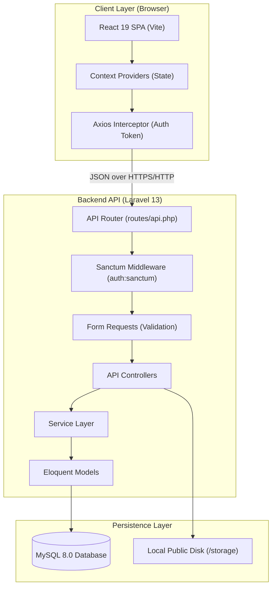
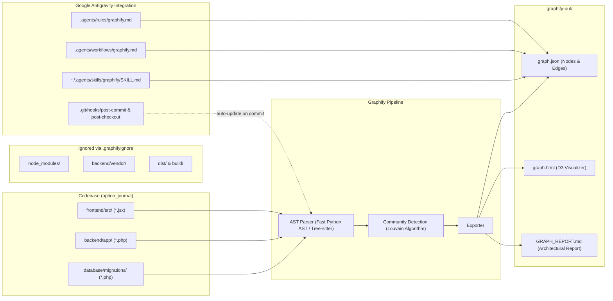

# ARCHITECTURE — TradeJournal

## 1. Architectural Overview

TradeJournal follows a modern decoupled **Client-Server Architecture**:
- **Frontend**: Single Page Application (SPA) built with React 19 and Vite 6, styled with Tailwind CSS v4.
- **Backend**: RESTful API service built with Laravel 13 (PHP 8.3+), leveraging Laravel Sanctum for stateful token-based authentication.
- **Database**: MySQL 8.x relational database with transactional integrity and strict foreign key cascading.



---

## 2. Frontend Architecture (React 19 + Vite)

### 2.1 State Management via React Context
The application relies on lightweight, modular React Contexts rather than an external state library:

1. **`AuthContext.jsx`**: Handles user authentication, token storage in `localStorage`, user session caching, dual username/email login, and registration.
2. **`ThemeContext.jsx`**: Multi-theme state engine supporting **Zerodha Kite Platform Theme** (`theme-kite`), **Midnight Dark** (`dark`), **Light Mode** (`light`), and **System** preference with `localStorage` persistence and automatic OS preference sync.
3. **`FilterContext.jsx`**: Global date range filter state (e.g. *Today, Yesterday, Next Working Day, This Week, This Month, Last Month, This Year, Custom Date Range*). Includes automatic next working day calculation skipping both weekends and Indian stock market holidays.
4. **`LotSizeContext.jsx`**: Dynamic per-index lot sizes (NIFTY: 75/50, BANKNIFTY: 30/15, SENSEX: 10, etc.) synced with database and localStorage fallback.
5. **`BrokerageContext.jsx`**: Dynamic brokerage and statutory tax rates schedule (brokerage per order, STT %, exchange %, GST %, SEBI fees, stamp duty).
6. **`DropdownContext.jsx`**: Module-wise custom dropdown options (Indices, Strategies, Types, Expiries) synced with backend `DropdownOption` model.
7. **`ModuleContext.jsx`**: Dynamic navigation module visibility (allows user to show/hide any module from Sidebar and MobileNav).
8. **`ToastContext.jsx`**: Centralized toast notification system (`showToast` and `addToast`) for feedback alerts.

### 2.2 Component Hierarchy & Layout
```
App.jsx (Root Router)
│
├── Public Routes (Unauthenticated)
│   ├── /login -> Login.jsx
│   └── /register -> Register.jsx
│
└── Protected Routes (Wrapped in AppLayout)
    ├── AppLayout.jsx
    │   ├── Sidebar.jsx (Desktop Navigation)
    │   ├── Navbar.jsx (Header, Global Date Filter, Profile Pill)
    │   ├── MobileNav.jsx (Bottom bar for mobile devices)
    │   └── Page Outlet
    │       ├── Dashboard.jsx
    │       ├── AddTrade.jsx
    │       ├── AllTrades.jsx
    │       ├── TradingCalendar.jsx
    │       ├── EquityCurve.jsx
    │       ├── RiskManagement.jsx
    │       ├── TradingJournal.jsx
    │       ├── StrategyAnalysis.jsx
    │       ├── AnalyticsReports.jsx
    │       ├── CapitalManagement.jsx
    │       ├── DropdownManager.jsx
    │       ├── PineScriptManager.jsx
    │       └── Settings.jsx
```

### 2.3 Shared & Reusable Components
- **`components/common/StatsCard.jsx`**: Reusable KPI card with trend indicators, tooltip help, and custom styling.
- **`components/common/ErrorBoundary.jsx`**: React class error boundary preventing catastrophic UI crashes.
- **`components/trades/EditTradeModal.jsx`**: Tabbed modal for updating trade records, option legs, charges, and notes.
- **`components/trades/BulkImportModal.jsx`**: Wizard for parsing and bulk importing trade logs from Zerodha CSV exports.
- **`components/trades/ExportModal.jsx`**: Multi-format report generator (Excel `.xlsx`, CSV, PDF) with customizable date ranges and column toggles.

---

## 3. Backend Architecture (Laravel 13 REST API)

### 3.1 Route & Middleware Structure
- **Public Endpoints**: `/api/login`, `/api/register`, `/api/ping`.
- **Protected Endpoints**: All operational routes are protected by `auth:sanctum` middleware, verifying the Bearer token in the `Authorization` header.

### 3.2 Service Layer Pattern
To prevent bloated controllers, heavy business logic is decoupled into dedicated services:
1. **`TradingCalculationService.php`**:
   - Calculates turn-key Indian regulatory charges:
     $$\text{STT} = \text{Exit Turnover} \times \text{STT Rate}$$
     $$\text{Exchange Fee} = (\text{Entry Turnover} + \text{Exit Turnover}) \times \text{Exchange Rate}$$
     $$\text{SEBI Fee} = (\text{Total Turnover}) \times \frac{\text{SEBI Rate}}{10{,}000{,}000}$$
     $$\text{GST} = (\text{Brokerage} + \text{Exchange Fee} + \text{SEBI Fee}) \times 18\%$$
     $$\text{Stamp Duty} = \text{Entry Turnover} \times 0.003\%$$
     $$\text{Total Charges} = \text{Brokerage} + \text{STT} + \text{Exchange Fee} + \text{GST} + \text{SEBI Fee} + \text{Stamp Duty}$$
     $$\text{Net P\&L} = \text{Gross P\&L} - \text{Total Charges}$$
2. **`TradingAnalyticsService.php`**:
   - Computes KPI metrics: Total Trades, Win Rate %, Profit Factor, Max Drawdown, Average Win, Average Loss, Expectancy Ratio, Daily P&L Series, and Cumulative Equity Curve.
3. **`ExportService.php`**:
   - Formats tabular trade records for CSV, Excel (`.xlsx`), and PDF generation via DomPDF.

### 3.3 Controller Inventory
- `AuthController`: Handles user registration, dual login (username/email/name), token revocation, profile update, password change.
- `DashboardController`: Supplies aggregated dashboard KPIs, recent trades, and monthly/daily P&L series.
- `TradeController`: Full CRUD for trades, multi-leg price extraction, bulk import/delete, screenshot uploads, charges estimation.
- `CalendarController`: Daily P&L aggregations, win/loss day counts, and daily trading summaries.
- `RiskController`: Daily/monthly risk limit configurations and live violation alerts.
- `JournalController`: Trade reflections, psychological tagging, lessons learned, and multi-tab drawer data.
- `StrategyController`: Strategy-specific trade performance and catalog management.
- `PineScriptController`: TradingView Pine Script repository, bookmarking, duplication, JSON import/export.
- `CapitalController`: Initial capital management and deposit/withdrawal transactions.
- `AnalyticsController`: Deep-dive multi-dimensional trading analytics.
- `LotSizeController`: User-specific and default index lot sizes.
- `ModuleVisibilityController`: Persists visible/hidden navigation modules per user.
- `BrokerageSettingController`: Custom brokerage fees and regulatory rates.
- `DropdownOptionController`: Dynamic dropdown options system.
- `ExportController`: Document generation (Excel, CSV, PDF, Full System JSON Backup & Restore).

---

## 4. Security Architecture

- **Authentication**: Stateful or Bearer token Sanctum tokens. Passwords hashed using `bcrypt` via `Hash::make()`.
- **Validation**: Strict Form Requests (`LoginRequest`, `RegisterRequest`, `StoreTradeRequest`, `UpdateTradeRequest`) with validation rules.
- **SQL Injection Prevention**: PDO parameterized queries via Eloquent ORM.
- **File Upload Security**: Mime-type and extension validation (`image/*`, max 10MB) stored on protected filesystem paths.
- **CORS**: Configured in Laravel with allowed origins and headers.

---

## 5. Knowledge Graph & Tooling Architecture (Graphify)

The codebase incorporates an AST-based Knowledge Graph layer powered by **Graphify** (`graphifyy`) for dependency discovery, call graph extraction, and AI agent grounding:



### Knowledge Graph Components
1. **Extraction Engine**:
   - Parses 139 core application code and documentation files without external network calls or LLM dependencies.
   - Extracts 785 nodes, 1025 edges, and 97 communities.
2. **Exclusion Boundary (`.graphifyignore`)**:
   - Prevents bloat by omitting `backend/vendor/` (9,000+ framework files) and `node_modules/`.
3. **Query Interface**:
   - `graphify query`: Performs breadth-first graph traversal for contextual questions.
   - `graphify path`: Discovers shortest call paths between symbols.
   - `graphify explain`: Summarizes node attributes, inbound/outbound edges, and file origins.
4. **Antigravity Rule Integration**:
   - Projects rules in `.agents/rules/graphify.md` require querying `graph.json` before answering architecture questions or planning major refactors.

---

## 6. Broker Integrations Architecture (Zerodha Kite Connect)

TradeJournal integrates with Zerodha Kite Connect in a **Strictly Read-Only** architectural configuration:

```mermaid
graph LR
    subgraph Frontend ["React SPA (/zerodha & /settings)"]
        UI["Zerodha.jsx Page"]
        MODAL["ZerodhaConnectModal"]
        SETT["Settings.jsx (Integrations Tab)"]
    end

    subgraph Backend ["Laravel API Layer"]
        CTRL["ZerodhaController"]
        SVC["ZerodhaKiteService"]
        MODEL["ZerodhaIntegration (Eloquent)"]
    end

    subgraph External ["External / Simulated"]
        KITE["Zerodha Kite Connect API (v3)"]
        DEMO["Sandbox Mock Engine"]
    end

    subgraph DB ["MySQL Database"]
        ZTABLE[("zerodha_integrations")]
        TTABLE[("trades & trade_orders")]
    end

    UI --> CTRL
    MODAL --> CTRL
    SETT --> CTRL
    CTRL --> SVC
    SVC --> MODEL
    MODEL --> ZTABLE
    SVC -.->|GET Read-Only| KITE
    SVC -.->|Simulated Data| DEMO
    SVC -->|Import Orders (Read-Only)| TTABLE
```

### Architectural Guarantees
1. **Zero Order Execution Capability**: The `ZerodhaKiteService` contains no methods or endpoints for placing, modifying, or canceling orders.
2. **Dual-Mode Operation**:
   - **Live Mode**: Directly queries Kite v3 endpoints (`/user/margins`, `/orders`, `/portfolio/positions`, `/portfolio/holdings`) using official daily session access tokens.
   - **Demo / Sandbox Mode**: Provides zero-subscription simulated data mirroring live Indian index options (NIFTY, SENSEX) and equity holdings only when explicitly activated.
3. **No Dummy Data on Live Connections**: Live connected integrations never return fallback mock orders. If the daily session requires re-authentication, the system renders `needs_auth` with 1-Click Kite login (`https://kite.zerodha.com/connect/login?v=3&api_key=...`) and automated callback exchange.
4. **One-Click Read-Only Journal Ingestion**: Ingests executed broker orders into internal `trades` and `trade_orders` models with automated brokerage and regulatory tax computation without broker write-backs.
