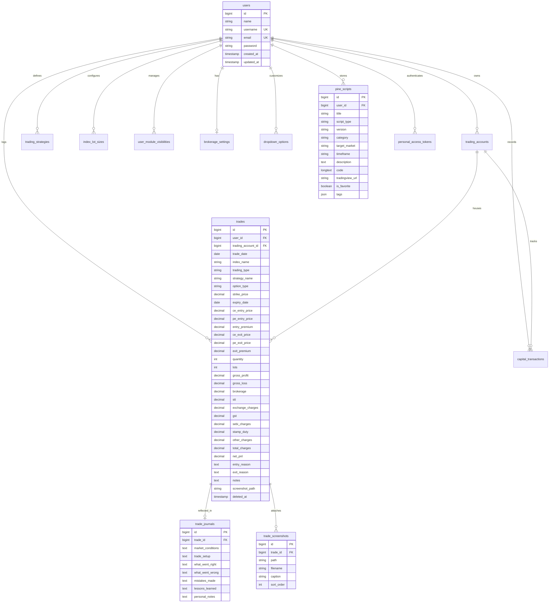

# DATABASE SCHEMA — TradeJournal

## 1. Overview

- **Database Engine**: MySQL 8.x / MariaDB
- **Character Set**: `utf8mb4`
- **Collation**: `utf8mb4_unicode_ci`
- **ORM**: Laravel Eloquent
- **Migration Path**: `backend/database/migrations`

---

## 2. Entity-Relationship Diagram

---

## 3. Detailed Table Specifications

### 3.1 `users`
Stores user identities, credentials, and profile settings.
| Column | Type | Nullable | Default | Description |
|---|---|---|---|---|
| `id` | BIGINT UNSIGNED | No | AUTO_INCREMENT | Primary Key |
| `name` | VARCHAR(255) | No | - | Trader display name |
| `username` | VARCHAR(50) | Yes | NULL | Unique trader handle for login |
| `email` | VARCHAR(255) | No | - | Unique email address for login |
| `email_verified_at` | TIMESTAMP | Yes | NULL | Email verification timestamp |
| `password` | VARCHAR(255) | No | - | Bcrypt hashed password |
| `remember_token` | VARCHAR(100) | Yes | NULL | Remember me token |
| `created_at` | TIMESTAMP | Yes | NULL | Creation timestamp |
| `updated_at` | TIMESTAMP | Yes | NULL | Last update timestamp |

**Indexes**:
- `PRIMARY` (`id`)
- `users_username_unique` (`username`)
- `users_email_unique` (`email`)

---

### 3.2 `trading_accounts`
Stores broker accounts, capital baselines, and risk threshold limits per trader.
| Column | Type | Nullable | Default | Description |
|---|---|---|---|---|
| `id` | BIGINT UNSIGNED | No | AUTO_INCREMENT | Primary Key |
| `user_id` | BIGINT UNSIGNED | No | - | Foreign Key -> `users.id` (ON DELETE CASCADE) |
| `account_name` | VARCHAR(255) | No | 'Primary Account' | Name of the trading account |
| `broker_name` | VARCHAR(255) | Yes | 'Zerodha' | Broker name |
| `initial_capital` | DECIMAL(15,2) | No | 500000.00 | Baseline starting capital (₹) |
| `daily_profit_target` | DECIMAL(15,2) | No | 20000.00 | Daily target for profit (₹) |
| `daily_max_loss` | DECIMAL(15,2) | No | 25000.00 | Maximum daily loss tolerance (₹) |
| `monthly_profit_target` | DECIMAL(15,2) | No | 150000.00 | Monthly profit goal (₹) |
| `monthly_max_loss` | DECIMAL(15,2) | No | 100000.00 | Maximum monthly loss tolerance (₹) |
| `is_default` | BOOLEAN | No | 1 (true) | Whether this is the active default account |
| `created_at` | TIMESTAMP | Yes | NULL | Creation timestamp |
| `updated_at` | TIMESTAMP | Yes | NULL | Last update timestamp |

**Indexes**:
- `PRIMARY` (`id`)
- `trading_accounts_user_id_is_default_index` (`user_id`, `is_default`)

---

### 3.3 `trades`
Core repository of executed option trades and full regulatory fee breakdowns.
| Column | Type | Nullable | Default | Description |
|---|---|---|---|---|
| `id` | BIGINT UNSIGNED | No | AUTO_INCREMENT | Primary Key |
| `user_id` | BIGINT UNSIGNED | No | - | Foreign Key -> `users.id` (ON DELETE CASCADE) |
| `trading_account_id` | BIGINT UNSIGNED | No | - | Foreign Key -> `trading_accounts.id` (ON DELETE CASCADE) |
| `trade_date` | DATE | No | - | Date of trade execution |
| `index_name` | VARCHAR(50) | No | - | Symbol / Index (e.g. NIFTY, BANKNIFTY) |
| `trading_type` | VARCHAR(30) | No | - | Execution type (Intraday, BTST, Positional) |
| `strategy_name` | VARCHAR(100) | No | - | Strategy name (e.g. Long Straddle) |
| `option_type` | VARCHAR(20) | No | - | Option leg type (CE, PE, Both) |
| `strike_price` | DECIMAL(15,2) | Yes | NULL | Option strike price (e.g. 24500) |
| `expiry_date` | DATE | Yes | NULL | Contract expiry date |
| `ce_entry_price` | DECIMAL(15,2) | Yes | NULL | Specific Call CE entry price |
| `pe_entry_price` | DECIMAL(15,2) | Yes | NULL | Specific Put PE entry price |
| `entry_premium` | DECIMAL(15,2) | Yes | NULL | Combined or single leg entry premium |
| `ce_exit_price` | DECIMAL(15,2) | Yes | NULL | Specific Call CE exit price |
| `pe_exit_price` | DECIMAL(15,2) | Yes | NULL | Specific Put PE exit price |
| `exit_premium` | DECIMAL(15,2) | Yes | NULL | Combined or single leg exit premium |
| `quantity` | INT | Yes | NULL | Total executed contract quantity |
| `lots` | INT | Yes | 1 | Number of lots traded |
| `gross_profit` | DECIMAL(15,2) | No | 0.00 | Gross profit before charges |
| `gross_loss` | DECIMAL(15,2) | No | 0.00 | Gross loss before charges |
| `brokerage` | DECIMAL(15,2) | No | 0.00 | Total broker execution fee |
| `stt` | DECIMAL(15,2) | No | 0.00 | Securities Transaction Tax (on sell premium) |
| `exchange_charges` | DECIMAL(15,2) | No | 0.00 | NSE / BSE transaction turnover fee |
| `gst` | DECIMAL(15,2) | No | 0.00 | 18% GST on (Brokerage + Txn + SEBI) |
| `sebi_charges` | DECIMAL(15,2) | No | 0.00 | SEBI turnover regulatory fee |
| `stamp_duty` | DECIMAL(15,2) | No | 0.00 | State stamp duty (on buy premium) |
| `other_charges` | DECIMAL(15,2) | No | 0.00 | Miscellaneous broker or clearing fees |
| `total_charges` | DECIMAL(15,2) | No | 0.00 | Sum of all statutory taxes and brokerage |
| `net_pnl` | DECIMAL(15,2) | No | 0.00 | Net realized P&L after all charges |
| `entry_reason` | TEXT | Yes | NULL | Setup reason / entry trigger rationale |
| `exit_reason` | TEXT | Yes | NULL | Exit rationale / target or stop loss hit |
| `notes` | TEXT | Yes | NULL | General trade execution notes |
| `screenshot_path` | VARCHAR(255) | Yes | NULL | Primary chart screenshot path |
| `created_at` | TIMESTAMP | Yes | NULL | Creation timestamp |
| `updated_at` | TIMESTAMP | Yes | NULL | Last update timestamp |
| `deleted_at` | TIMESTAMP | Yes | NULL | Soft delete timestamp |

**Indexes**:
- `PRIMARY` (`id`)
- `trades_user_id_trade_date_index` (`user_id`, `trade_date`)
- `trades_user_id_index_name_index` (`user_id`, `index_name`)
- `trades_user_id_strategy_name_index` (`user_id`, `strategy_name`)
- `trades_user_id_net_pnl_index` (`user_id`, `net_pnl`)

---

### 3.4 `trade_journals`
Stores deep psychological reflections, post-trade reviews, and lessons learned.
| Column | Type | Nullable | Default | Description |
|---|---|---|---|---|
| `id` | BIGINT UNSIGNED | No | AUTO_INCREMENT | Primary Key |
| `trade_id` | BIGINT UNSIGNED | No | - | Foreign Key -> `trades.id` (ON DELETE CASCADE) |
| `market_conditions` | TEXT | Yes | NULL | Market environment (Trending, Choppy, Rangebound) |
| `trade_setup` | TEXT | Yes | NULL | Detailed technical setup description |
| `what_went_right` | TEXT | Yes | NULL | Execution strengths |
| `what_went_wrong` | TEXT | Yes | NULL | Execution flaws or mistakes |
| `mistakes_made` | TEXT | Yes | NULL | Trading rules violated |
| `lessons_learned` | TEXT | Yes | NULL | Future takeaways |
| `personal_notes` | TEXT | Yes | NULL | Emotional and personal state notes |
| `created_at` | TIMESTAMP | Yes | NULL | Creation timestamp |
| `updated_at` | TIMESTAMP | Yes | NULL | Last update timestamp |

---

### 3.5 `trade_screenshots`
Stores multiple image attachments per trade record.
| Column | Type | Nullable | Default | Description |
|---|---|---|---|---|
| `id` | BIGINT UNSIGNED | No | AUTO_INCREMENT | Primary Key |
| `trade_id` | BIGINT UNSIGNED | No | - | Foreign Key -> `trades.id` (ON DELETE CASCADE) |
| `path` | VARCHAR(500) | No | - | Storage path on disk |
| `filename` | VARCHAR(255) | Yes | NULL | Original filename |
| `caption` | VARCHAR(255) | Yes | NULL | Screenshot caption (e.g. Entry Setup) |
| `sort_order` | INT UNSIGNED | No | 0 | Display sequence order |
| `created_at` | TIMESTAMP | Yes | NULL | Creation timestamp |
| `updated_at` | TIMESTAMP | Yes | NULL | Last update timestamp |

---

### 3.6 `pine_scripts`
Repository for TradingView Pine Script code, alerts, and parameters.
| Column | Type | Nullable | Default | Description |
|---|---|---|---|---|
| `id` | BIGINT UNSIGNED | No | AUTO_INCREMENT | Primary Key |
| `user_id` | BIGINT UNSIGNED | No | - | Foreign Key -> `users.id` (ON DELETE CASCADE) |
| `title` | VARCHAR(255) | No | - | Script title |
| `script_type` | VARCHAR(255) | No | 'indicator' | Type: `indicator`, `strategy`, `library`, `alert` |
| `version` | VARCHAR(255) | No | 'v5' | Pine version: `v4`, `v5`, `v6` |
| `category` | VARCHAR(255) | No | 'Options' | Category (Options, Price Action, Volatility) |
| `target_market` | VARCHAR(255) | No | 'All' | Market: NIFTY, BANKNIFTY, Equity, All |
| `timeframe` | VARCHAR(255) | No | '5m' | Timeframe (1m, 3m, 5m, 15m, Daily) |
| `description` | TEXT | Yes | NULL | Summary of rules and indicators |
| `code` | LONGTEXT | No | - | Full Pine Script code |
| `tradingview_url` | VARCHAR(255) | Yes | NULL | Web link to TradingView published script |
| `is_favorite` | BOOLEAN | No | 0 (false) | Starred bookmark flag |
| `tags` | JSON | Yes | NULL | JSON array of search tags |
| `created_at` | TIMESTAMP | Yes | NULL | Creation timestamp |
| `updated_at` | TIMESTAMP | Yes | NULL | Last update timestamp |

---

### 3.7 `dropdown_options`
Dynamic, user-customizable dropdown catalog across modules.
| Column | Type | Nullable | Default | Description |
|---|---|---|---|---|
| `id` | BIGINT UNSIGNED | No | AUTO_INCREMENT | Primary Key |
| `user_id` | BIGINT UNSIGNED | No | - | Foreign Key -> `users.id` (ON DELETE CASCADE) |
| `module_key` | VARCHAR(50) | No | - | Target module (`add-trade`, `trades`, `journal`, `global`) |
| `dropdown_key` | VARCHAR(50) | No | - | Field key (`index_name`, `strategy_name`, `trading_type`) |
| `dropdown_label` | VARCHAR(100) | No | - | Human-readable label (e.g. 'Trading Strategy') |
| `option_value` | VARCHAR(100) | No | - | Internal value (e.g. 'Long Straddle') |
| `option_label` | VARCHAR(150) | No | - | Display label |
| `is_active` | BOOLEAN | No | 1 (true) | Whether visible in form dropdowns |
| `sort_order` | INT | No | 0 | Display sequence order |
| `is_system` | BOOLEAN | No | 1 (true) | True for default seeds, False for custom user additions |
| `color` | VARCHAR(50) | Yes | NULL | Optional color badge |
| `metadata` | JSON | Yes | NULL | Additional metadata payload |
| `created_at` | TIMESTAMP | Yes | NULL | Creation timestamp |
| `updated_at` | TIMESTAMP | Yes | NULL | Last update timestamp |

**Unique Constraint**: `['user_id', 'module_key', 'dropdown_key', 'option_value']`

---

### 3.8 `brokerage_settings`
Configurable tax and brokerage schedule per user.
| Column | Type | Nullable | Default | Description |
|---|---|---|---|---|
| `id` | BIGINT UNSIGNED | No | AUTO_INCREMENT | Primary Key |
| `user_id` | BIGINT UNSIGNED | No | - | Foreign Key -> `users.id` (UNIQUE, ON DELETE CASCADE) |
| `broker_name` | VARCHAR(50) | No | 'Zerodha' | Default broker |
| `brokerage_per_order` | DECIMAL(10,2) | No | 20.00 | Brokerage charged per order leg (₹) |
| `stt_rate_percent` | DECIMAL(10,5) | No | 0.15000 | STT percentage (0.15% on sell turnover) |
| `nse_txn_rate_percent` | DECIMAL(10,5) | No | 0.03553 | NSE turnover fee % |
| `bse_txn_rate_percent` | DECIMAL(10,5) | No | 0.03250 | BSE turnover fee % |
| `gst_rate_percent` | DECIMAL(10,2) | No | 18.00 | GST percentage (18%) |
| `sebi_per_crore` | DECIMAL(10,2) | No | 10.00 | SEBI fee (₹10 per crore turnover) |
| `stamp_duty_rate_percent` | DECIMAL(10,5) | No | 0.00300 | Stamp duty percentage (0.003% on buy turnover) |
| `default_exchange` | VARCHAR(10) | No | 'NSE' | Default exchange (NSE / BSE) |
| `created_at` | TIMESTAMP | Yes | NULL | Creation timestamp |
| `updated_at` | TIMESTAMP | Yes | NULL | Last update timestamp |

---

### 3.9 `user_module_visibilities`
Persists customizable sidebar/navigation module visibility.
| Column | Type | Nullable | Default | Description |
|---|---|---|---|---|
| `id` | BIGINT UNSIGNED | No | AUTO_INCREMENT | Primary Key |
| `user_id` | BIGINT UNSIGNED | No | - | Foreign Key -> `users.id` (ON DELETE CASCADE) |
| `module_key` | VARCHAR(50) | No | - | Navigation key (e.g. `trades`, `calendar`, `journal`) |
| `is_visible` | BOOLEAN | No | 1 (true) | Visibility flag |
| `sort_order` | INT | No | 0 | Navigation sort sequence |
| `created_at` | TIMESTAMP | Yes | NULL | Creation timestamp |
| `updated_at` | TIMESTAMP | Yes | NULL | Last update timestamp |

---

### 3.10 `index_lot_sizes`
Configurable derivative lot sizes per index.
| Column | Type | Nullable | Default | Description |
|---|---|---|---|---|
| `id` | BIGINT UNSIGNED | No | AUTO_INCREMENT | Primary Key |
| `user_id` | BIGINT UNSIGNED | No | - | Foreign Key -> `users.id` (ON DELETE CASCADE) |
| `index_name` | VARCHAR(50) | No | - | Index symbol (NIFTY, BANKNIFTY, SENSEX, etc.) |
| `lot_size` | INT | No | 50 | Units per single derivative lot |
| `exchange` | VARCHAR(20) | No | 'NSE' | Exchange (NSE / BSE) |
| `display_name` | VARCHAR(100) | Yes | NULL | Friendly name |
| `is_active` | BOOLEAN | No | 1 (true) | Active status |
| `created_at` | TIMESTAMP | Yes | NULL | Creation timestamp |
| `updated_at` | TIMESTAMP | Yes | NULL | Last update timestamp |

---

### 3.11 `capital_transactions`
Records deposits and withdrawals impacting available trading capital.
| Column | Type | Nullable | Default | Description |
|---|---|---|---|---|
| `id` | BIGINT UNSIGNED | No | AUTO_INCREMENT | Primary Key |
| `user_id` | BIGINT UNSIGNED | No | - | Foreign Key -> `users.id` (ON DELETE CASCADE) |
| `trading_account_id` | BIGINT UNSIGNED | No | - | Foreign Key -> `trading_accounts.id` (ON DELETE CASCADE) |
| `transaction_type` | VARCHAR(20) | No | - | Type (`deposit` / `withdrawal`) |
| `amount` | DECIMAL(15,2) | No | - | Transaction amount (₹) |
| `transaction_date` | DATE | No | - | Date of capital movement |
| `notes` | TEXT | Yes | NULL | Transaction notes / bank reference |
| `created_at` | TIMESTAMP | Yes | NULL | Creation timestamp |
| `updated_at` | TIMESTAMP | Yes | NULL | Last update timestamp |
