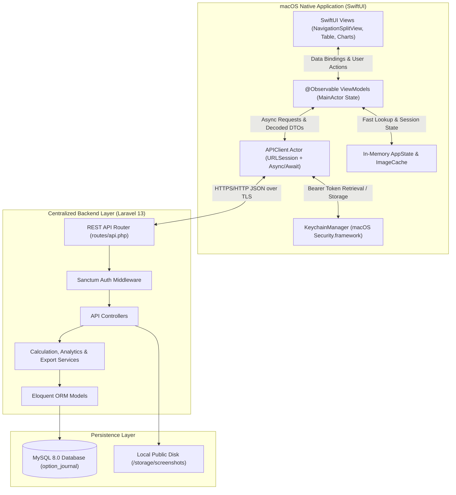

# ARCHITECTURE — OptionJournal macOS Native Application

## 1. Architectural Philosophy & Principles

OptionJournal for macOS is engineered as a **100% native desktop client** following **Clean Architecture** and the **MVVM (Model-View-ViewModel)** design pattern. It operates as a thin, responsive, and robust frontend consuming the centralized Laravel REST backend.

### Key Architectural Mandates
1. **Centralized Business Logic**: All financial calculations (brokerage, STT, exchange turnover fees, GST, SEBI fees, stamp duty, gross/net P&L) and analytics aggregations remain strictly on the Laravel backend. The macOS app does not duplicate regulatory calculation formulas.
2. **Zero Non-Native Wrappers**: Absolutely no Electron, React Native, Chromium Embedded Framework, or WebViews for core functionality.
3. **Strict Concurrency**: Built with Swift 6 Concurrency (`async`/`await`, structured task groups, `@MainActor`, and background `Actor`s) eliminating data races.
4. **Hardware-Accelerated UI**: SwiftUI declarative layouts backed by Metal and native macOS AppKit rendering pipelines.
5. **Secure by Default**: Cryptographic token storage via the native macOS Keychain (`Security.framework`).

---

## 2. High-Level System Architecture



---

## 3. Core Architectural Layers

### 3.1 Presentation Layer (SwiftUI Views)
The presentation layer is composed strictly of declarative SwiftUI views optimized for desktop mouse, trackpad, and keyboard interaction:
- **`NavigationSplitView`**: Three-column / two-column primary layout (Sidebar navigation on the left, primary content list/table in the center, and optional inspector drawer on the right).
- **Native `Table`**: Multi-column compact data tables with sorting support via `KeyPathComparator`, selectable rows, contextual right-click menus, and keyboard navigation.
- **`Swift Charts` Framework**: High-performance charting using Apple's official `Charts` framework for Daily P&L bar charts, Equity Curve lines, Drawdown areas, and Index distribution donuts.
- **Window & Toolbar Management**: Native macOS `WindowGroup` with customizable toolbar items (`.toolbar`, `.searchable`, keyboard shortcuts `⌘N`, `⌘R`, `⌘E`).

### 3.2 State & Logic Layer (MVVM ViewModels)
ViewModels bridge the UI and the network layer using Swift's Observation framework (`@Observable`):
- All ViewModels are isolated to the `@MainActor` to guarantee thread-safe UI updates.
- ViewModels manage loading states (`idle`, `loading`, `loaded`, `failed(APIError)`).
- ViewModels transform backend DTO models into display-ready strings (e.g., currency formatting with Indian Lakh/Crore delimiters, profit/loss coloration).
- ViewModels orchestrate user actions (CRUD operations, pagination, filtering, search debounce).

### 3.3 Networking Layer (`URLSession` + Swift Concurrency)
The network layer is managed by an isolated `actor APIClient`:
- **`Endpoint` Protocol**: Strongly typed enum defining HTTP methods (`GET`, `POST`, `PUT`, `DELETE`), path fragments, URL query parameters, and JSON request bodies.
- **`URLSession` Execution**: Utilizes asynchronous network tasks (`session.data(for: request)`).
- **Authentication Interception**: The `APIClient` automatically retrieves the active Sanctum token from `KeychainManager` and appends `Authorization: Bearer <token>` to all protected calls.
- **401 Unauthorized Recovery**: Intercepts HTTP 401 responses, clears invalid credentials, and triggers an application-wide transition to the unauthenticated login state.
- **Multipart Form Uploads**: Custom multipart streaming helper for uploading chart screenshots with mime-type validation.

### 3.4 Security & Credential Storage Layer
Authentication tokens and sensitive credentials are never stored in `UserDefaults` or plaintext property lists:
- **`KeychainManager`**: Direct wrapper around the native macOS Keychain API (`SecItemAdd`, `SecItemCopyMatching`, `SecItemUpdate`, `SecItemDelete`).
- **Keys Managed**:
  - `optionjournal.auth.token`: Plaintext Sanctum Bearer token.
  - `optionjournal.auth.user`: Cached user profile JSON.
- **Keychain Access Control**: Bound strictly to the application's bundle identifier (`devplaceholder.ZRPCRCA3.OptionJournal`) with `kSecAttrAccessibleAfterFirstUnlock`.

---

## 4. Navigation & Window Architecture

OptionJournal macOS adheres to the official Apple Human Interface Guidelines (HIG) for desktop applications:

```
┌────────────────────────────────────────────────────────────────────────────────────────┐
│ [ ● ● ● ]  OptionJournal ─ Trading Terminal                🔍 Search   [📅 Period ▾]  [+ Add Trade] │
├─────────────────┬─────────────────────────────────────────────────┬────────────────────┤
│ 📊 Dashboard    │ Trade-by-Trade Log                             │ Inspector / Detail │
│ ➕ Add Trade    │                                                 │                    │
│ 📋 All Trades   │ ┌───┬────────────┬──────┬─────────┬───────────┐ │ NIFTY 23900 CE     │
│ 📅 Calendar     │ │ # │ Date       │ Sym  │ Strike  │ Net P&L   │ │ ────────────────── │
│ 📈 Equity Curve │ ├───┼────────────┼──────┼─────────┼───────────┤ │ Trade Specs:       │
│ 🛡️ Risk Guard   │ │ 1 │ 2026-10-31 │ NIFTY│ 23900 CE│ +₹4,520   │ │ Entry: ₹125.40   │
│ 📖 Journal      │ │ 2 │ 2026-10-31 │ BN   │ 51200 PE│ -₹1,850   │ │ Exit:  ₹155.60   │
│ 🎯 Strategies   │ │ 3 │ 2026-10-30 │ NIFTY│ 24100 CE│ +₹8,900   │ │ Lots:  4 (300)   │
│ 📊 Analytics    │ └───┴────────────┴──────┴─────────┴───────────┘ │ Charges: ₹124.50   │
│ 💰 Capital      │                                                 │ Net:     +₹8,935.5 │
│ 🌲 Pine Scripts │                                                 │ ────────────────── │
│ ⚙️ Settings     │                                                 │ Reflections & Notes│
└─────────────────┴─────────────────────────────────────────────────┴────────────────────┘
```

---

## 5. Offline, Caching & Error Handling Strategy

1. **Transient Network Errors**:
   - `URLSession` network failures (timeout, connection refused, offline) are captured and mapped into clear, human-readable Swift `APIError` cases.
   - Dedicated `Retry` buttons in error state views allow traders to re-execute queries without app restarts.
2. **Read-Through In-Memory Caching**:
   - Immutable metadata such as **Indices**, **Default Lot Sizes**, and **Dropdown Options** are cached in an application-level container upon successful authentication, reducing redundant network requests.
3. **Data Loss Prevention**:
   - Forms (e.g. Add Trade, Pine Script Editor) maintain local `@State` bindings so unsaved draft inputs are preserved in view memory if a network call encounters a temporary failure.
